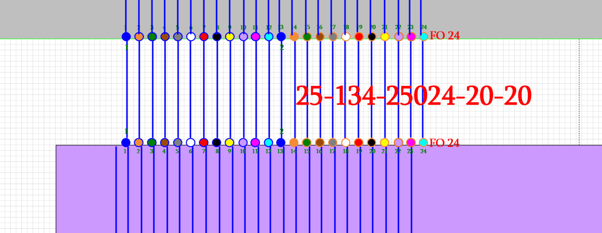
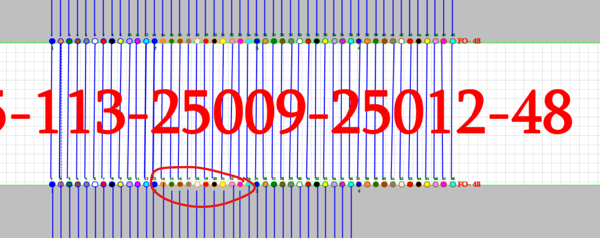

# Iteration 38 — repair drawing mistakes during import; correct the network in Fiber Atlas

Owner requirements recorded **2026-10-12**. **Status: Ready for worker implementation.** This is the next product milestone. It incorporates the unfinished Iteration 37 correction-retention work and supersedes its requirement to manually Remap every mechanically displaced bank. The owner explicitly authorizes automatic interpretation of the described drawing mistakes during import; do not ask for the same confirmation per Fiber or per bank that matches the approved rule.

## Outcome the owner wants

Import Visio into an understandable, usable network. Recognize accidental row displacement, shortened/disconnected drawing strokes and routine fill/shade mistakes. Correct their digital interpretation automatically. Keep those repairs out of the actionable review queue. Preserve valid splices and cable-specific color sequences. Let the owner correct real numbering, connections and duplicate identities **inside Fiber Atlas**, without returning to Visio or navigating the current multi-step technical forms.

The owner's clarification is decisive: a line outside its intended circle can be a drawing error; an SC connection described as **orange/blue → blue/blue** can be correct. **Do not equalize colors across a splice.** A valid connection may join differently colored Fibers/banks. Automatic visual cleanup must not change that connection.

The original source stays available. A short “Corrected during import” summary and optional history provide traceability; they are not a second approval queue. Import activation still has one explicit Add/update action. Parser work and local tests do not authorize changing the owner's active database in this planning session.

## Exact examples and current limitations

### A. AP20 — a displaced AP-side row

Owner explanation: AP-side lines moved left accidentally. This is a drafting displacement, not an intended Fiber-number offset. The Cable is `25-134-25024-20-20`, SC25024 ↔ AP20. Prior raw label capacity20 conflicts with actual complete 24F banks and FO24 labels. The capacity repair is already implemented locally; the new normalization must use that resolved24F capacity before reconstructing the AP-side association.

Exact existing-source anchors: label78894, banks11797/12096, FO texts11798/12097, physical-span lines11562–11585. Existing source-only tests yield F1→Port2 through F23→Port24, Port1 unbound; an owner Remap currently makes F1→Port1 through F24→Port24. **New acceptance: importing this recognized mechanical pattern produces the intended all-24 mapping directly**, with repair provenance and no manual bank Remap/review requirement. Do not merely move the rendered lines while leaving the old graph underneath.

Apply the same reusable pattern to equivalent banks, including previously corrected AP18 when the source evidence matches. Do not hard-code AP20/AP18, Shape IDs, the number24, or this file's checksum as the repair algorithm.

### B. SC25009–SC25012 — short strokes and lost continuation

The screenshot corresponds to `25-113-25009-25012-48`, label Shape7858. The stored semantic artifact identifies bank8327 at SC25009 (node7762) and bank7886 at SC25012 (node7878); both have a complete numbered48F bank. Representative F13/F24 marker IDs are8354/8362 and8127/8135 respectively. The current parser reports no accepted physical pair and no accepted transitions referencing this Cable: the visible drafting gaps have wider consequences than one missing line on screen.

Treat the owner's statement as confirmation that the pictured gaps are mechanical errors. Inspect the entire local source to distinguish short strokes, translated groups, undrawn intra-Cable depiction and a genuinely absent inter-Cable splice target. Recover the uniquely determined intended bank/Cable links. Do not continue the route by choosing another Cable merely because it is nearby or next in the display.

Relevant neighboring labels for investigation: `25-109-25008-25009-48`, `25-114-25012-25013-48`, `25-110-25009-25010-24`, `25-295-25009-55-24`. They are context, **not a prescribed continuation**.

### C. New Visio revisions currently fail an exact-hash gate

`scripts/interpret-shida-upload.py` currently requires one `OWNER_SOURCE_SHA`; another SHA produces a blocker before source interpretation. That prevents ordinary corrected versions of the same drawing from using the grammar. Replace that gate with a versioned, explicitly scoped drawing-family profile and structural recognition. Keep SHA for original evidence, integrity, cache keys and revision identity, not as the only test of whether the family can be parsed.

The owner says numbering and duplicates have been corrected in Visio. Preserve the old file as a regression fixture; the newer file must be handled as an update to the same document. This planning pass has not imported or certified that newer file. Future repairs must also be possible entirely in Fiber Atlas.

## Interpretation contract

Use an explicit sequence: retain original bytes/Shapes → identify family/profile and stable local objects → resolve Cable capacity and numbered banks → normalize approved mechanical patterns → construct canonical bindings/transitions → apply still-valid persistent Atlas edits → validate and summarize the resulting network.

Normalization changes the **derived interpretation**, not source coordinates/bytes. Retain original and normalized endpoints/colors/values, source run/page/Shape IDs, rule/profile version, owner policy reference and reason. The UI normally shows the corrected digital network; original evidence is one click away, visibly identified as the original drawing.

Distinguish three kinds of output:

| Output | What the user sees |
| --- | --- |
| Recognized owner-approved mechanical repair | Usable corrected connection/attribute; optional import-summary entry; no Needs Review badge/case. |
| Valid source mapping, including a deliberate SC color/number change | Preserve the mapping; do not “repair” it into a standard sequence. |
| Genuinely unknown endpoint/identity or competing physical mappings | One plain actionable item at the relevant Cable/bank, with a simple way to supply the missing fact. Never silently choose an arbitrary endpoint. |

Unresolved color alone must not block otherwise known connectivity or generate hundreds of required decisions. Original differences remain inspectable. Do not convert all old issues to resolved by hiding rows; a repair must alter/establish the corresponding canonical fact, or explicitly be attribute-only.

## Parser tasks

### 38-01 — Versioned drawing-family profile and update support

**Ready.** Implement the owner-approved mechanical-error policy for the Shida family, recognizing local bank/number/FO/line/container structure. Do not infer all semantics from filename, label text or a boolean “ignore errors.” Recognized unchanged portions of a new source version should remain usable when another object type is unsupported; report the unsupported scope specifically.

Record the policy once, including automatic row alignment, endpoint-gap repair and fill/shade normalization. Reuse it for matching future imports. Preserve exact source hashes and version all derived caches. Modified same-family fixtures with new SHAs must pass recognition; unrelated or ambiguous structures must not acquire Shida connections. Reprocessing the same source/profile must be deterministic and idempotent.

### 38-02 — Recover uniformly displaced AP/bank connections

**Ready.** Detect a coherent displacement of a connector row relative to its intended numbered bank using group relationships, ordered endpoints, pitch, orientation/transforms and the neighboring connected structure. Fit and validate the row as a whole rather than assigning each stroke to whichever circle is nearest.

Use unique Cable identity, complete range/printed labels, capacity and ownership to disambiguate repeated colors. Validate one-to-one assignments and every affected member; detect partial/mixed-Cable banks. Preserve explicit exceptions and deliberately routed/permuted mappings. A blue circle repeats at F1/F13/F25/F37; “blue to blue” alone is insufficient to select which one.

Calibrate rule limits against actual source measurements and record residuals. This is a bounded structural repair, not a larger global snapping radius. Test uniform displacement left/right and transformed layouts as well as nearby unrelated lines. Repair the actual Port/Fiber graph and dependent paths, keeping original geometry available. AP20 all24 must be handled in one import operation; no individual confirmations or hidden manual corrections.

### 38-03 — Recover short strokes and omitted depiction without losing true gaps

**Ready.** Extend a shortened open stroke to its unique intended marker using its direction, source transform, bank pitch and a coherent row pattern. Handle open geometry paths as well as Visio connector cells. Bound the operation to the relevant Cable/bank/container so branches, crossings and neighboring rows do not get joined.

For an omitted line **within one identified physical Cable**, two uniquely associated numbered endpoint banks and the approved depiction pattern can establish the same existing Fiber's endpoint correspondence; do not require every decorative span stroke when the owner-approved structure establishes it. Record which links were repaired rather than literally drawn.

For a missing **splice between different Cables**, require an unambiguous target from the complete local evidence or an explicit saved owner range-connection rule. A physical Cable's two ends and a splice between Cables are different facts. If the full source leaves multiple possible outgoing endpoints, expose one simple range-connection action; do not manufacture a destination from matching colors, free endpoints, route order or an expected AGG.

Use screenshot B as an end-to-end fixture: associate the actual48F banks, restore the supported continuation, recompute the complete journey, and enumerate any truly unspecified onward endpoints. Report exact recovered Fiber numbers and paths. Do not claim that a visually complete line implies the entire end-to-end route is known.

### 38-04 — Normalize fill/shade mistakes while preserving legitimate color changes

**Ready.** Keep marker inner fill, outer ring and connector line color as distinct source properties. Preserve the owner's `orange/blue → blue/blue` valid SC transition. Do not collapse that pair to a single color or assume outer-ring equality is required for a splice. Do not infer a physical Tube identity solely from ring color without the source profile defining it.

Use the source family's semantic palette and explicit shade aliases; normalize known equivalent shades to one displayed color. A line's drawing color is not the Fiber's physical color. Maintain printed Fiber identities and Cable-specific sequences: a changed sequence can be legitimate and must not be overwritten with a global repeating12-color rule.

Correct an inconsistent fill on the **same established Fiber/marker identity** when the profile, saved Cable sequence or unambiguous corroborating bank pattern determines the intended color. Keep the raw occurrences and normalization basis. The eight existing violet-shade comparisons are regression inputs: recognized shade/fill mistakes should leave the actionable queue after normalization, with no optical edge created by color alone.

If neither profile nor consistent local evidence determines which of two different valid colors is intended, do not invent a physical color. Leave that attribute explicitly unknown/uncertain, preserve connectivity, and offer one optional Cable/profile color edit instead of a blocking per-Fiber review process. This boundary does not weaken the requirement to automatically repair the recognized cases above.

## Persistent Atlas edits and simple interaction

### 38-05 — Keep valid Atlas corrections across imports

**Ready; incorporates37-01/02/05.** Store an explicit Atlas correction as persistent intent on the relevant object/field/connection, not only an event that a new source proposal can discard. Existing confirmed corrections and explicit exceptions take precedence over generic mechanical normalization. If the new parser produces the same connection, classify it as agreement rather than asking the owner to reconfirm or creating a duplicate binding.

Carry a correction forward automatically when document/object identities, endpoints, capacity and invariants still match. This follows the owner's request to maintain corrections in Atlas; it supersedes the older blanket rule against replaying any human correction. Retain exact evidence and original history. When the source truly changes the object/endpoint/capacity or invalidates occupancy, ask one focused choice: keep the valid Atlas edit, use the new source, or leave that update pending. Never apply an invalid retained mapping or silently supersede an explicit edit.

Whole-bank edits remain atomic. Handle same-file reprocessing, revised-file imports, changed parser versions and changed Shape IDs using the existing document-revision/identity model. Do not use AP number or identical Cable text as a universal cross-document identity. Where stable matching is unavailable, show the unmatched object explicitly.

### 38-06 — Replace technical correction forms with direct editing

**Ready.** Use one compact panel beside the selected object and its context. The everyday flow is **select the item → choose/change the connection or value → see a short before/after → Save**. One Save validates and applies a valid edit; the backend can keep digest/stale checks and immutable revisions internally. Remove separate mandatory draft/validate/apply pages, technical IDs, evidence-basis choices and typed justification for routine repairs. Collect source/location/actor automatically; an optional note is sufficient unless a particular exceptional decision needs explanation.

The panel always answers: **What is wrong? What will change?** Show the immediate connection and the full known journey, plus a small original-source toggle. Display relevant Port/Fiber numbers and their separate color markers. Keep the source and list scrollable; do not navigate to an empty object page. Show technical history only under Details.

| User action | Smallest useful control | Expected result |
| --- | --- | --- |
| Fix one connection | Select the other Cable/Fiber or Port from incident candidates | “Before: F7 → Port13; After: F7 → Port7,” with affected-route count and Save. Do not preselect a guess for an unknown endpoint. |
| Connect a range / align a bank | Choose source range and target start, or the recognized numbered alignment | One compact range preview, exceptions expanded only if present, one Save for the atomic change. |
| Correct a Port/Fiber number or label | Click value and enter the corrected value | Preserve underlying identity/references; if a number is occupied, offer a clear swap/change choice instead of breaking links. |
| Correct Cable capacity | Edit capacity with a preview of added/affected Fibers | Add known-range records appropriately; refuse silent deletion of connected Fibers when reducing capacity. |
| Resolve duplicate drawing/object | Show two local representations; choose “same physical object” or “separate objects” | Same-object reconciliation preserves both source representations and references; different objects remain distinct. Equal labels alone never merge them. |
| Correct a color/sequence | Pick semantic colors or a saved Cable sequence | Fix only the intended attributes; preserve valid splice relationships and custom sequence. |

After saving, show a short success message and **Undo**. Undo is an inverse validated change preserving history; conflicting later edits require a clear explanation. Ordinary corrections must not require returning to Visio. A real ambiguous branch may need a user-selected endpoint, but not another technical workflow.

### 38-07 — Import summary with useful repair accounting

**Ready; incorporates37-03/04.** Show a concise result such as “Imported · 12 drawing repairs · 2 connections need information.” Values must come from the actual run. Let the user expand repairs by Cable/bank with before/after examples. Do not present every repaired Fiber as a separate problem. “Needs Review” is reserved for remaining actionable ambiguity; keep original issues and resolutions available in history.

On an existing source, show “Update available / Reprocess saved file” when the interpreter/profile changes, and distinguish pending versus active results. Allow an updated Visio as a new version of that document. Show retained Atlas edits and genuine conflicts in the same impact preview. One explicit Add/update activates the validated candidate. No reset, new-document duplication or reupload workaround for parser updates.

A repair ledger should record stable repair ID, source revision/run/page/Shapes, object/field/endpoint, raw and normalized values, rule/profile/version, reason, changed graph facts and whether the result is active. It must be complete but loaded on demand; keep it out of the initial operational payload.

## 38-08 — Acceptance and delivery

**Ready after implementation.** Deliver in two usable stages: first38-01–05 and37's active-correction preservation, then the simplified editor/summary. Make the first stage inspectable with a compact before/after import summary even before the broader editor is complete. Update HANDOFF per task to In progress, Done with evidence, Blocked with the specific missing fact, or Deferred with a named follow-up.

Required evidence:

1. **AP20:** import24Fibers, recover intended F1→Port1…F24→Port24 automatically, no displacement/capacity nuisance review for the recognized repair; raw `…20` label and its correction remain in import history. Repeat import does not duplicate facts or ask for Remap. A legitimate smaller Cable in a larger AP bank still remains smaller.
2. **SC25009–SC25012:** exact banks and source strokes from screenshot B, accepted physical association, recovered supported continuations and full known paths. No false association to SC25010/AP55/another nearby Cable. Distinguish residual unspecified splice targets from repaired drawing gaps.
3. **Color semantics:** a shifted endpoint returns to its correct marker; valid orange/blue→blue/blue at SC stays unchanged. Repeated blue markers, changed/custom sequence, equivalent violet shades and line-color differences do not create false links. Pure color normalization leaves topology signatures unchanged.
4. **Negative geometry:** intentional permutations, branches/crossings, incomplete numbering, duplicate bank candidates, real unused endpoints, mixed Cable banks, large unrelated gaps, altered orientation and unsupported objects. No blanket nearest-circle matching or equal-color graph generation.
5. **New source versions:** same-family corrected content/new SHA is interpreted; old original still reproducible. Corrected numbering/duplicates do not resurrect old active issues. Unrelated source families remain isolated. A missing revised owner file limits only that final real-file check, not work on the preserved source and version-change fixtures.
6. **Correction retention:** current confirmed AP18/other edits survive compatible reprocessing; matching normalized results do not duplicate them. Changed identity/capacity/occupancy produces a focused conflict. Source rollback, edit Undo and whole-bank reversal preserve complete history and current graph consistency.
7. **Simple editor:** desktop1440/mobile390 one-connection, range, number, capacity, duplicate and color actions; ordinary edit uses one panel and one Save after preview. Keyboard, error/retry, stale state and Undo work. No raw Shape IDs, mandatory provenance fields or technical draft states in the main flow.
8. **Performance:** retain Iteration36 independent reads/caches and source scrolling; do not rerun full interpretation on pan, selection or edit preview. Record import and correction time/memory, list/crop timings and changed bundle/payload sizes. Bound normalization by local indexed groups rather than all-lines×all-markers scans.
9. **Accounting:** compare original accepted source, normalized candidate and active-with-Atlas-edits separately. Report changed Fibers, bindings, transitions, paths, automatic repairs and genuinely remaining issues. Do not use a target of zero total issues to justify guessing. Known approved mechanical cases must disappear from the actionable queue because their interpretation is repaired.

Use guarded disposable PostgreSQL/schema/storage for all mutations. No owner reset, migration, import activation or correction is part of implementing this brief. The owner will import/reprocess and activate the delivered behavior. Preserve existing TLS/config, exact-source evidence, AP16/Port13→SC25017→AP17 route and Tsageri/SC217→Lentekhi regressions. Older exact-path counts are baselines, not promises that newly repaired paths remain unchanged.

## Files to start from

- `scripts/interpret-shida-upload.py`: current exact-SHA gate and family entry point.
- `scripts/audit-iteration33-shida.py`, `scripts/shida_geometry.py`, `scripts/marker_geometry.py`: bank numbering, row ownership, physical pairs and directional gap checks.
- `scripts/compile-shida.ts`: canonical inventory/graph, colors, conflicts and review classification.
- `src/domain/portCorrection.ts`, `scripts/reconcile-import-corrections.ts`: typed edits and current supersede-only reconciliation.
- `src/components/PortCorrectionPanel.tsx`, `ImportCorrectionReconciliation.tsx`, `OwnerImportPanel.tsx`: existing multi-step correction/import interaction.
- `tests/shida-capacity-import.test.ts`, `tests/port-correction.test.ts`, `scripts/test-vsdx-importer.py`: extend positive and negative fixtures; do not delete deliberate unequal-number/unequal-color cases to make normalization pass.
- [Iteration37 review](ITERATION-37-IMPORT-COMPLETENESS-REVIEW.md), [source backlog](ITERATION-34-DIGITIZATION-BACKLOG.md), [performance delivery](ITERATION-36-IMPLEMENTATION-REVIEW.md): retained obligations and measured baselines.

Planning evidence: the two owner screenshots were copied byte-for-byte into this document's folder. The current gap rule only handles small directional gaps; the current48F example has no accepted bank pair in the regenerated semantic artifact. No new normalization code, parser test result, network activation or revised-file certification is claimed by this document.
